

# vgmu Gallery

A screen-by-screen tour of vgmu 1.1 in all three interfaces: <b>Console</b>, <b>PictoChat</b>, and <b>Clean</b>. The accent is pink in all three, and a few screens show dark appearance.

**[Start here](#start-here) · [Console](#console--home) · [PictoChat](#pictochat--home) · [Clean](#clean--home-and-library) · [Everywhere](#everywhere--albums-and-library-tools)**

---

## Start here

<b>The launch splash, the welcome, and the one-time offer of the new looks. vgmu has three interfaces that share one Library, one set of downloads, and every setting: switch between them anytime in Settings under Interface style.</b>

<table><tr>
<td align="center" width="280">
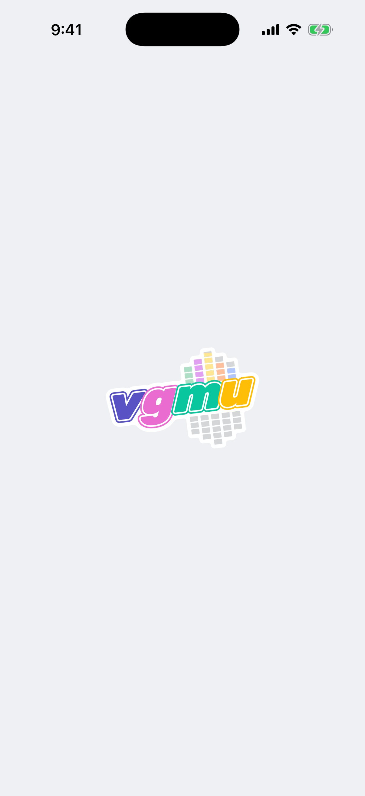 
<b>Figure 1 — Launch splash</b> The vgmu logo's EQ columns fill with color from left to right, drain, and fill again, in every interface, then the app fades in.
</td>
<td align="center" width="280">
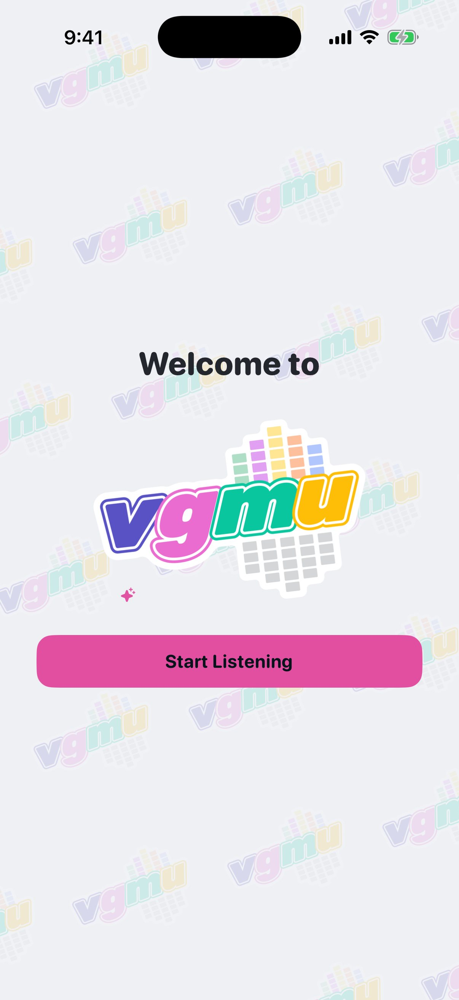 
<b>Figure 2 — Welcome to vgmu</b> The first launch: the new vector logo over a tiled logo backdrop and a single Start Listening button. No account, no sign-up.
</td>
<td align="center" width="280">
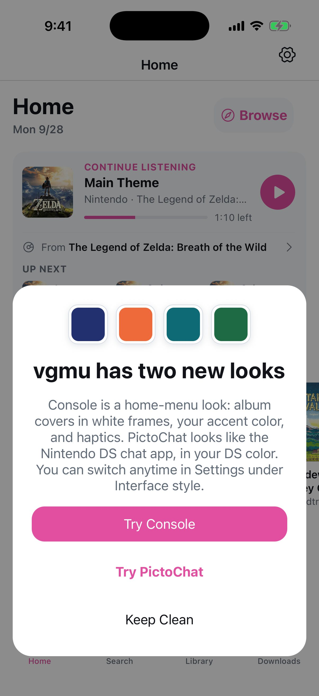 
<b>Figure 3 — Two new looks</b> People updating from 1.0 keep the Clean look they know and are offered Console or PictoChat once. Any choice can be changed later in Settings.
</td>
</tr></table>

<a href="#vgmu-gallery">↑ back to top</a>

---

## Console · Home

<b>Console is a home-menu interface after the Wii, Wii U, and 3DS system menus: covers in white bezels on a dotted shell, one accent color (pink here), SF Pro Rounded everywhere, and gentle motion.</b>

<table><tr>
<td align="center" width="280">
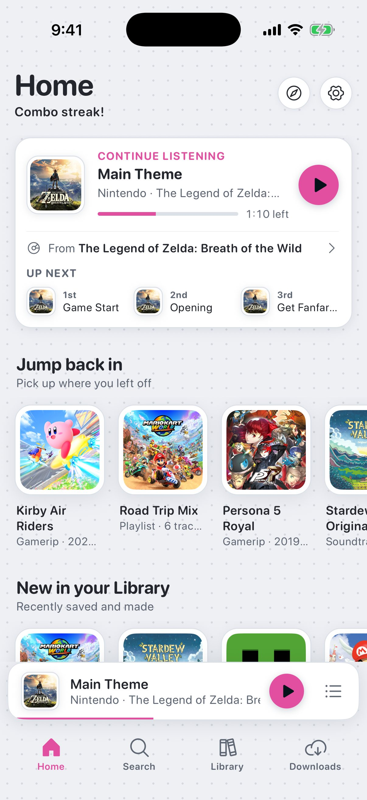 
<b>Figure 4 — Launch greeting</b> On the first Home visit after a cold start, a short game-flavored greeting for the time of day pops in letter by letter, then rolls up into the date.
</td>
<td align="center" width="280">
 
<b>Figure 5 — Home</b> Continue listening picks up the paused track with time left, where it plays from, and the next three tracks. Jump back in and New in your Library sit below, with Your Liked Tracks, Re-discover, Because you played, Trending now, and the catalog after them.
</td>
<td align="center" width="280">
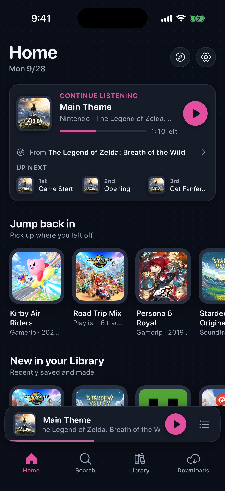 
<b>Figure 6 — Home in dark</b> The same Home on Console's navy-black shell. Appearance follows the device or can be pinned to Light or Dark.
</td>
</tr></table>

<a href="#vgmu-gallery">↑ back to top</a>

---

## Console · Browse, search, and albums

<b>Browse the charts, search the catalog with sort and filter chips, then open an album to play, save, or download it.</b>

<table><tr>
<td align="center" width="280">
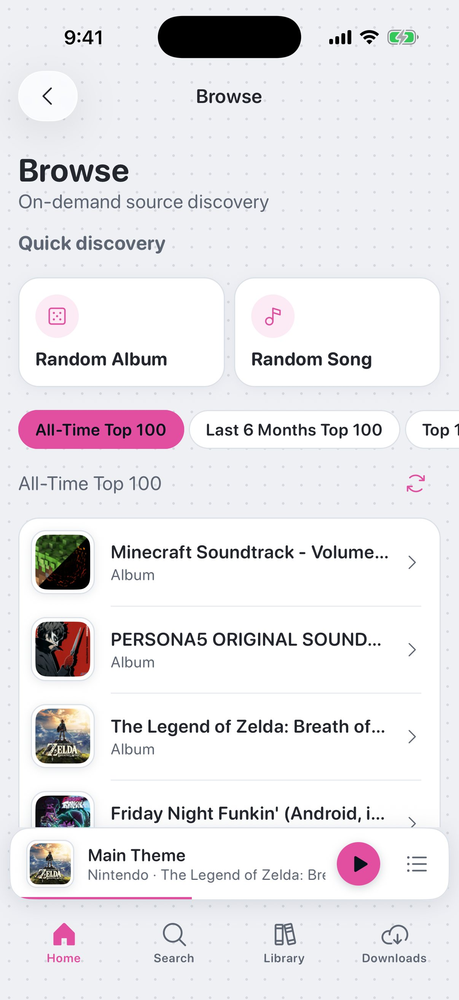 
<b>Figure 7 — Browse — All-Time Top 100</b> Random Album and Random Song up top, then chart presets like the All-Time Top 100 and the Last 6 Months Top 100.
</td>
<td align="center" width="280">
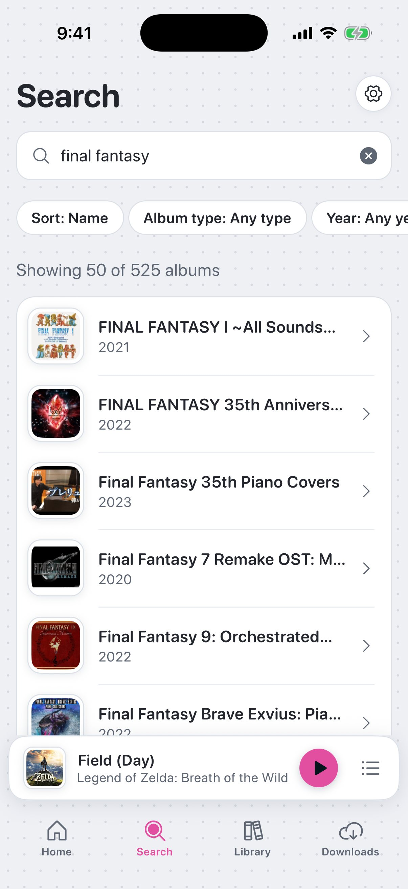 
<b>Figure 8 — Search — Final Fantasy</b> 525 matching albums with Sort, Album type, Year, and Platform chips above the results.
</td>
<td align="center" width="280">
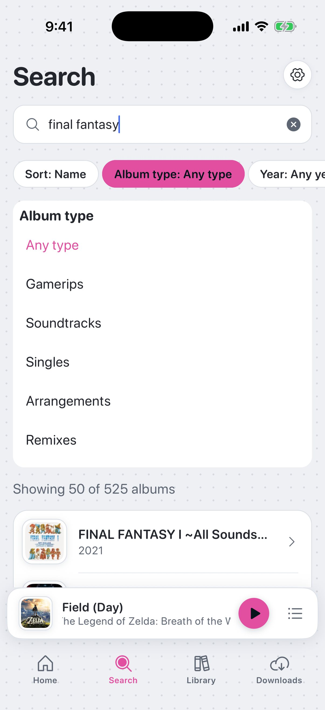 
<b>Figure 9 — Album type filter</b> Narrow results to gamerips, soundtracks, singles, arrangements, or remixes.
</td>
</tr></table>
<table><tr>
<td align="center" width="280">
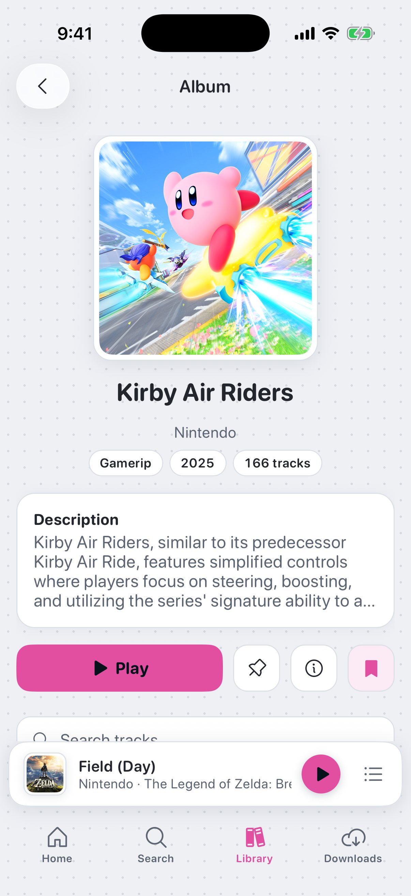 
<b>Figure 10 — Album — Kirby Air Riders</b> A saved album with its description, Play, pin, album information, and the saved bookmark.
</td>
<td align="center" width="280">
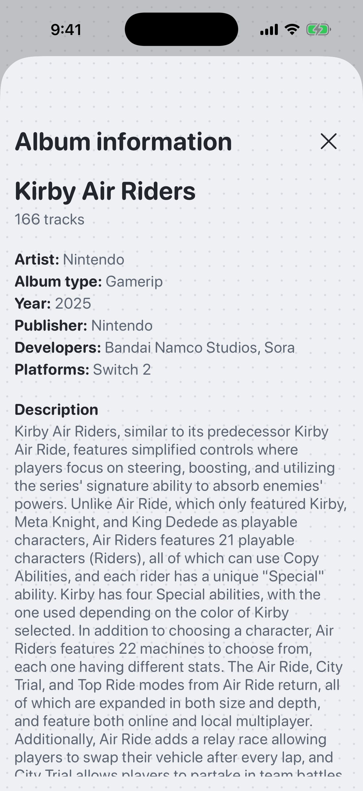 
<b>Figure 11 — Album information</b> Artist, type, year, publisher, developers, platforms, and the full description.
</td>
<td align="center" width="280">
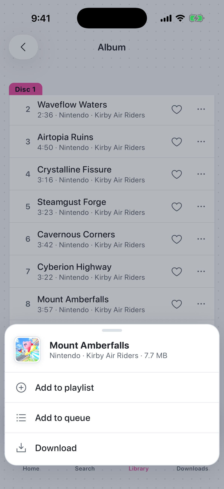 
<b>Figure 12 — Track actions</b> A track's ⋯ button opens a 3DS-style sheet with Add to playlist, Add to queue, and Download. The heart stays inline on the row.
</td>
</tr></table>

<a href="#vgmu-gallery">↑ back to top</a>

---

## Console · Library

<b>Your albums, playlists, folders, likes, and downloads, as a list or a grid of bezeled covers.</b>

<table><tr>
<td align="center" width="280">
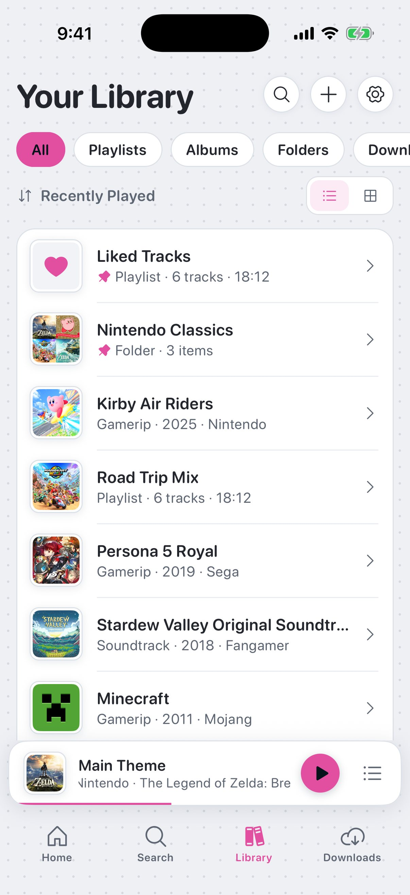 
<b>Figure 13 — Library</b> Liked Tracks and a folder pinned to the top, then collections by Recently Played, with filter chips for Playlists, Albums, Folders, and Downloaded.
</td>
<td align="center" width="280">
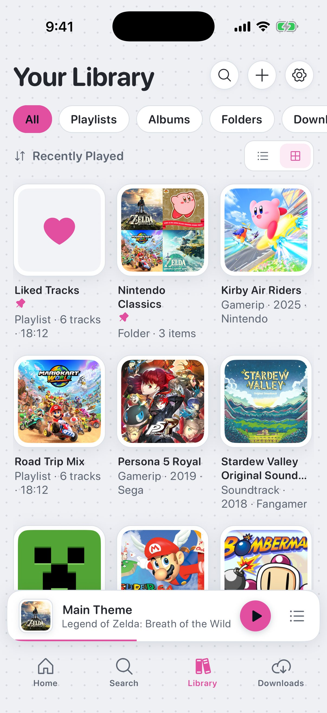 
<b>Figure 14 — Library grid</b> The same Library as a grid, with custom playlist and folder artwork.
</td>
<td align="center" width="280">
 
<b>Figure 15 — Library in dark</b> The list view on the dark shell.
</td>
</tr></table>
<table><tr>
<td align="center" width="280">
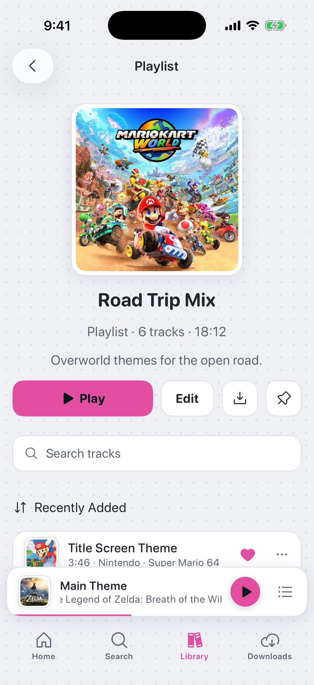 
<b>Figure 16 — Playlist — Road Trip Mix</b> A playlist with its own cover and description, Play, Edit, Download, and Pin.
</td>
<td align="center" width="280">
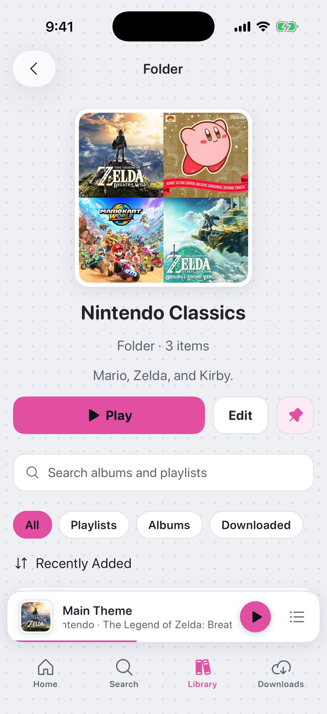 
<b>Figure 17 — Folder — Nintendo Classics</b> A folder grouping albums, with its own search and filter chips inside.
</td>
<td align="center" width="280">
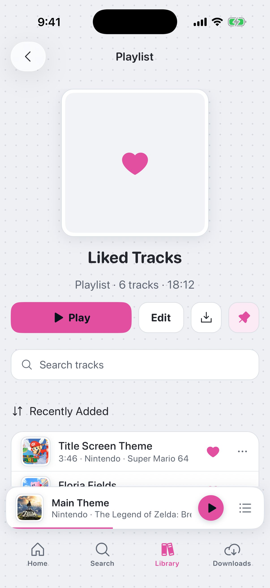 
<b>Figure 18 — Liked Tracks</b> Every liked track in one place, sorted by Recently Added.
</td>
</tr></table>
<table><tr>
<td align="center" width="280">
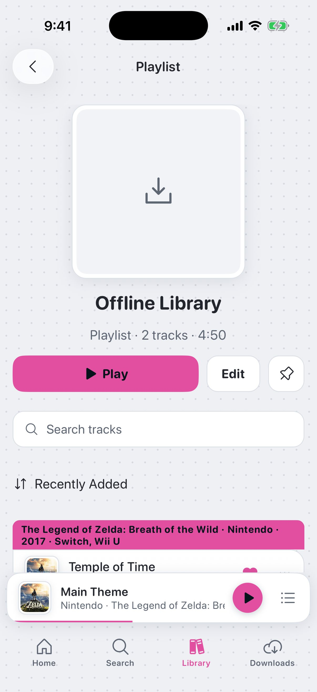 
<b>Figure 19 — Offline Library</b> Downloaded tracks, grouped by album, playable with no connection.
</td>
<td align="center" width="280">
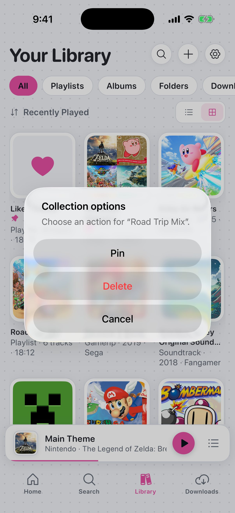 
<b>Figure 20 — Collection options</b> Hold a Library item to pin or delete it.
</td>
<td align="center" width="280"></td>
</tr></table>

<a href="#vgmu-gallery">↑ back to top</a>

---

## Console · Playback

<b>Now Playing in Console, with a choice of moving backgrounds behind the player while music plays.</b>

<table><tr>
<td align="center" width="280">
 
<b>Figure 21 — Now Playing — Notes</b> The cover in a white bezel with music notes in the logo's colors floating in and out behind it (the default background).
</td>
<td align="center" width="280">
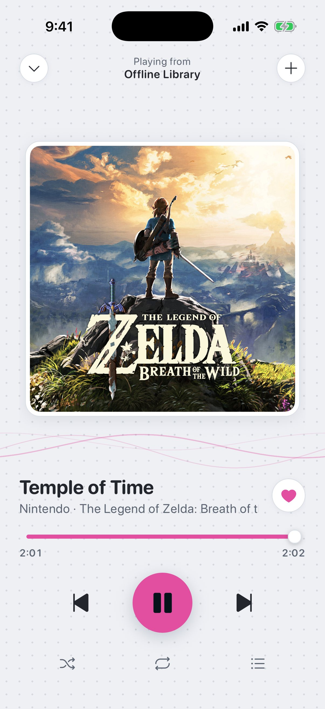 
<b>Figure 22 — Now Playing — XMB</b> The XMB wave rolling through the space between the cover and the title.
</td>
<td align="center" width="280">
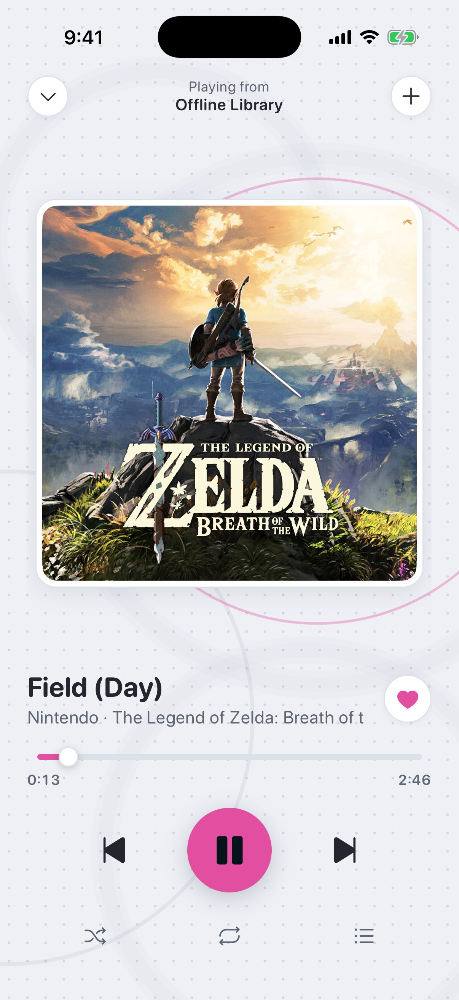 
<b>Figure 23 — Now Playing — Rings</b> Wii Menu style rings drifting slowly, one in your accent color.
</td>
</tr></table>
<table><tr>
<td align="center" width="280">
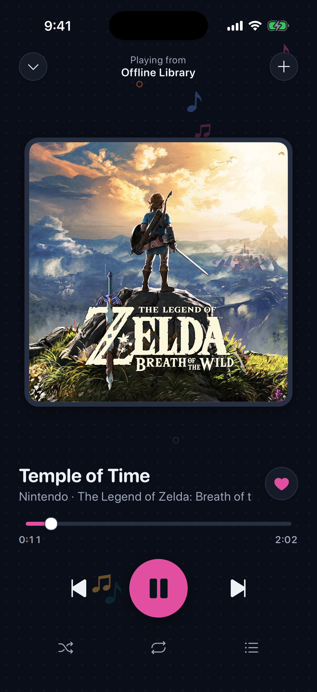 
<b>Figure 24 — Now Playing in dark</b> Notes on the dark shell.
</td>
<td align="center" width="280">
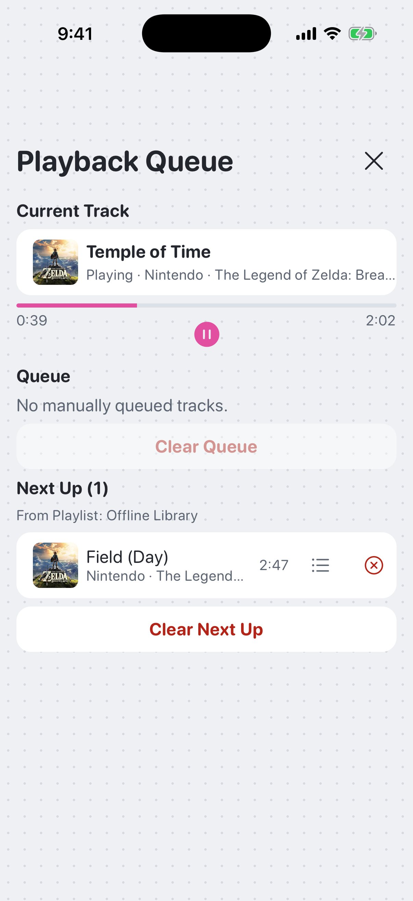 
<b>Figure 25 — Playback Queue</b> The current track, your manual queue, and Next Up from the playlist, each clearable.
</td>
<td align="center" width="280"></td>
</tr></table>

<a href="#vgmu-gallery">↑ back to top</a>

---

## Console · Downloads and settings

<b>Downloads, Settings, and the guide, all in Console's panels.</b>

<table><tr>
<td align="center" width="280">
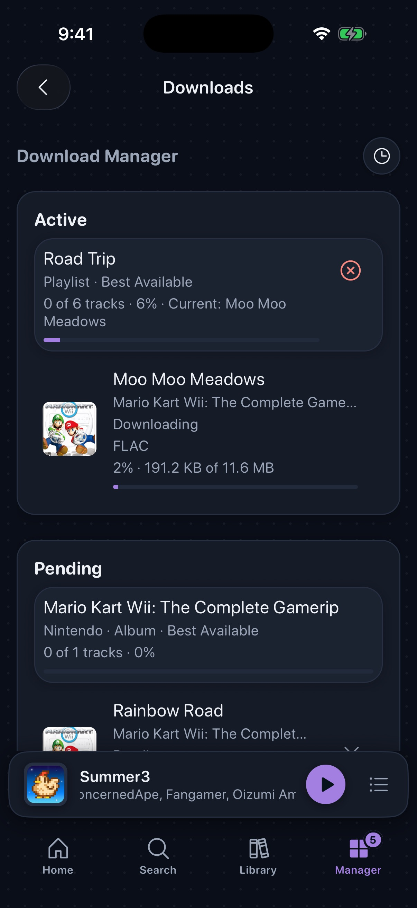 
<b>Figure 26 — Downloads</b> Active, Pending, Needs Attention, and Completed, with Play and Done on finished tracks.
</td>
<td align="center" width="280">
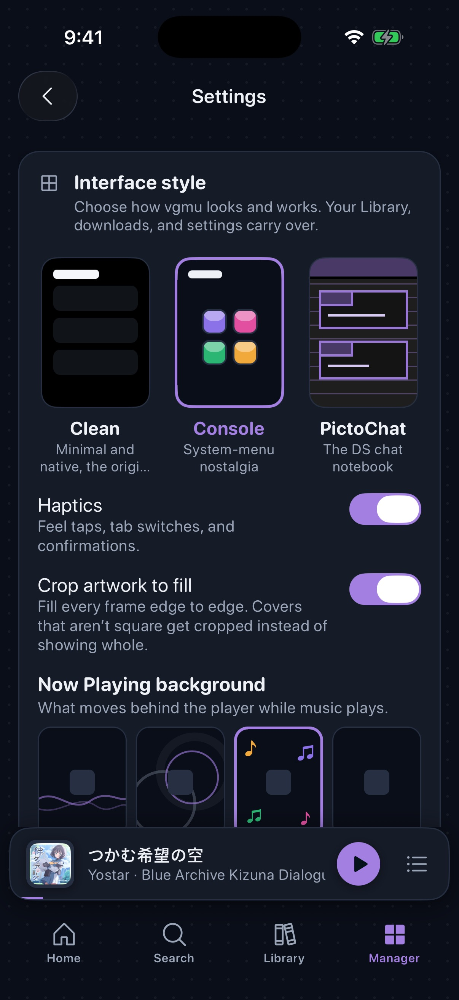 
<b>Figure 27 — Interface style</b> Pick Clean, Console, or PictoChat from picture cards. Haptics and Crop artwork to fill apply in every style.
</td>
<td align="center" width="280">
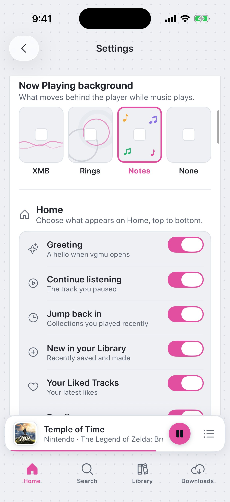 
<b>Figure 28 — Now Playing background and Home</b> Choose XMB, Rings, Notes, or None, and turn each part of Home on or off.
</td>
</tr></table>
<table><tr>
<td align="center" width="280">
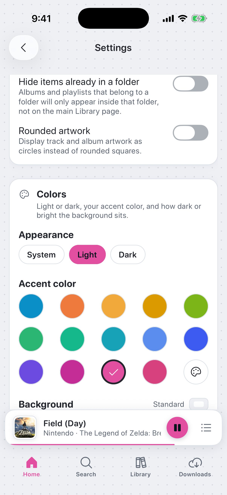 
<b>Figure 29 — Colors</b> Appearance, fifteen accent colors plus any custom color, and a Background slider from darker to brighter.
</td>
<td align="center" width="280">
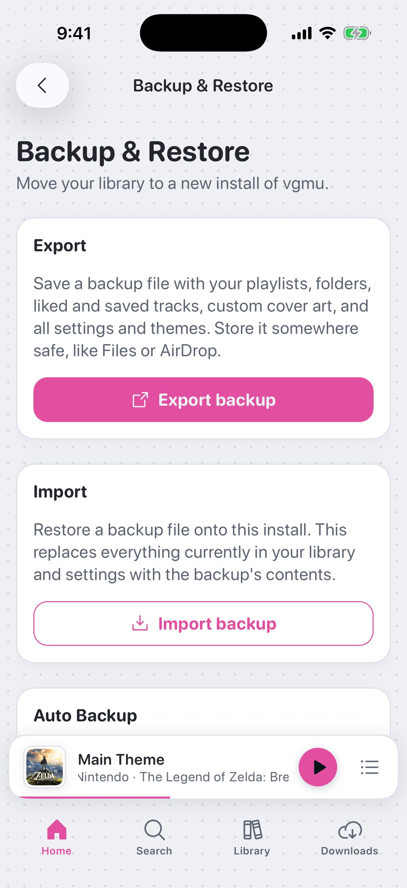 
<b>Figure 30 — Backup & Restore</b> Export a backup file, import one, or schedule automatic backups.
</td>
<td align="center" width="280">
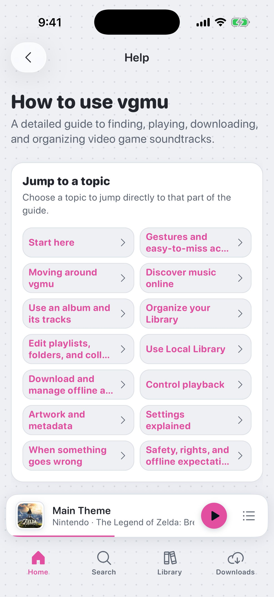 
<b>Figure 31 — Help</b> The in-app guide, with a topic index that jumps to each section.
</td>
</tr></table>
<table><tr>
<td align="center" width="280">
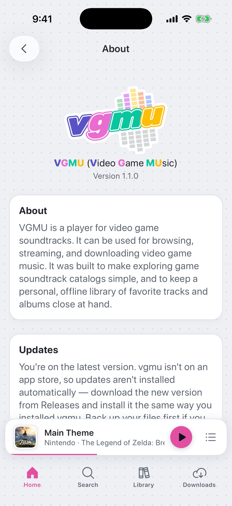 
<b>Figure 32 — About</b> The new logo, the version, and an update check.
</td>
<td align="center" width="280"></td>
<td align="center" width="280"></td>
</tr></table>

<a href="#vgmu-gallery">↑ back to top</a>

---

## PictoChat · Home

<b>PictoChat draws the same app like the Nintendo DS chat app: a pixel font, pixel-cornered messages with name tabs, DS buttons that press in, pixel icons, and your DS color (a custom pink here) on the DS menu's grid.</b>

<table><tr>
<td align="center" width="280">
 
<b>Figure 33 — Launch greeting</b> The greeting types itself in letter by letter, like the DS keyboard, in the colored title bar.
</td>
<td align="center" width="280">
 
<b>Figure 34 — Home</b> Continue listening as a message with its name tab, then Jump back in and New in your Library in pixel frames.
</td>
<td align="center" width="280">
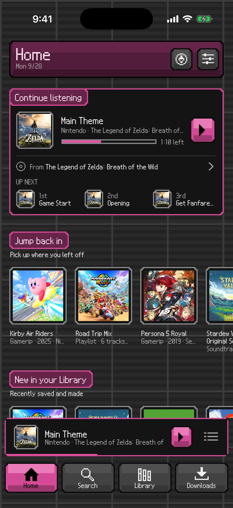 
<b>Figure 35 — Home in dark</b> An authored dark counterpart on a graphite grid, since the DS itself had no dark mode.
</td>
</tr></table>

<a href="#vgmu-gallery">↑ back to top</a>

---

## PictoChat · Browse, search, and albums

<b>Browse, search, albums, and track actions in DS materials.</b>

<table><tr>
<td align="center" width="280">
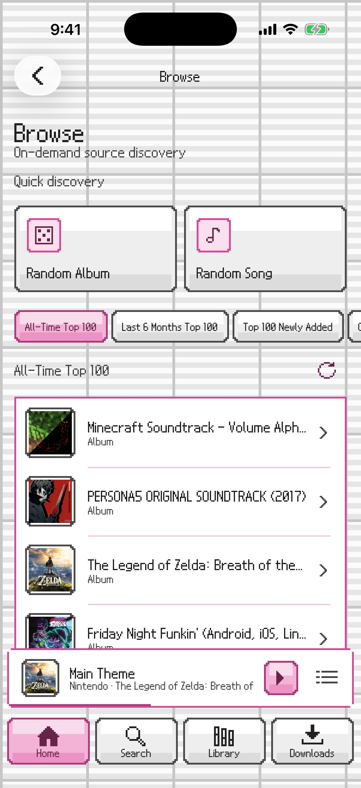 
<b>Figure 36 — Browse</b> Random Album and Random Song as DS buttons with pixel icons, and the chart presets below.
</td>
<td align="center" width="280">
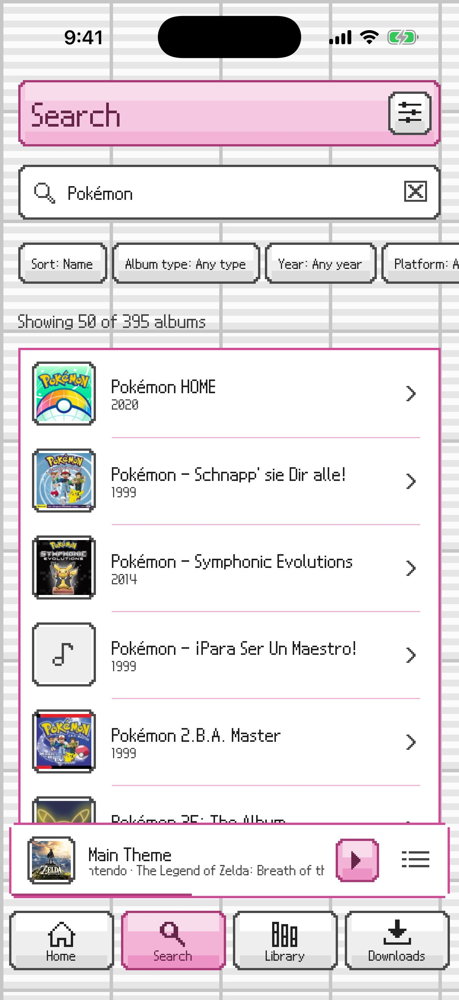 
<b>Figure 37 — Search — Pokémon</b> DS buttons for the filters and results outlined as one message.
</td>
<td align="center" width="280">
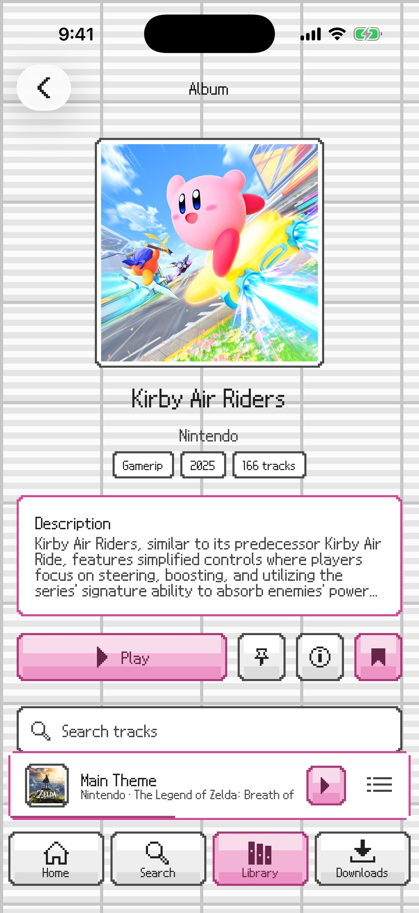 
<b>Figure 38 — Album — Kirby Air Riders</b> The cover in an ink frame with pixel corners, pixel-framed info tags, and DS buttons.
</td>
</tr></table>
<table><tr>
<td align="center" width="280">
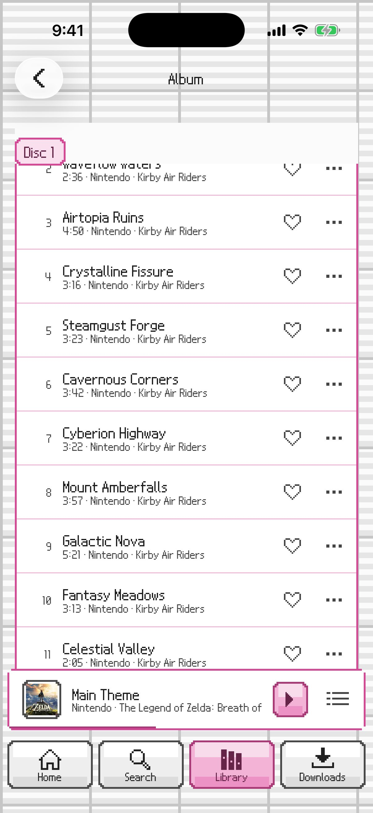 
<b>Figure 39 — Track list</b> Rows divided by pale ruled lines in your color, with a Disc name tab.
</td>
<td align="center" width="280">
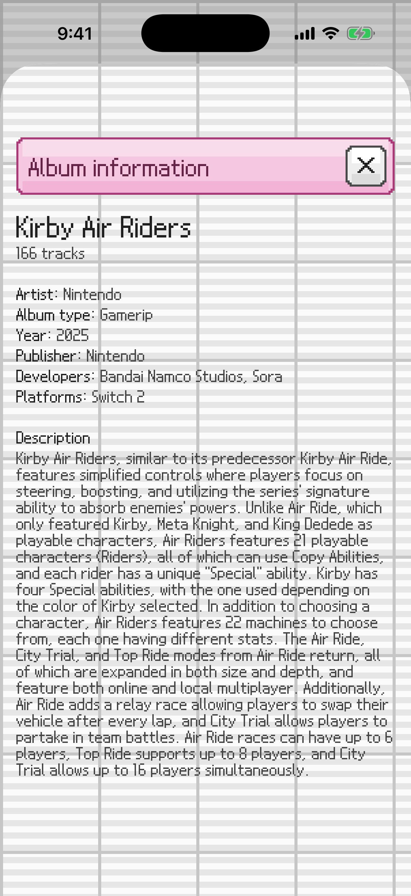 
<b>Figure 40 — Album information</b> Sheets get PictoChat's colored title bar and a DS close button.
</td>
<td align="center" width="280">
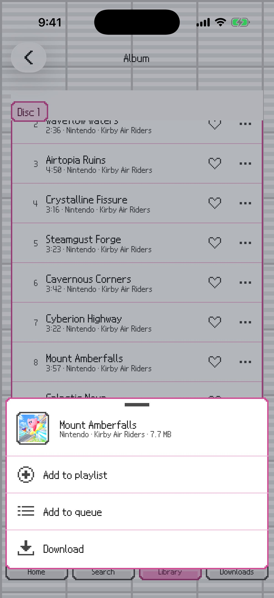 
<b>Figure 41 — Track actions</b> The ⋯ sheet in PictoChat, with pixel icons.
</td>
</tr></table>

<a href="#vgmu-gallery">↑ back to top</a>

---

## PictoChat · Library

<b>The Library as messages and pixel frames.</b>

<table><tr>
<td align="center" width="280">
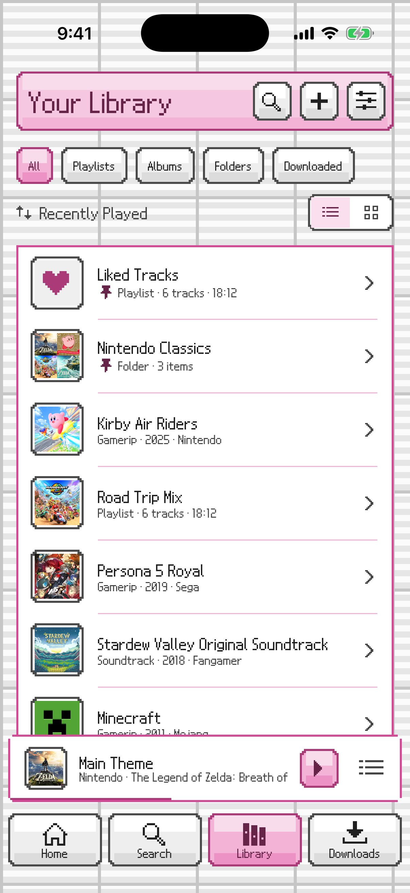 
<b>Figure 42 — Library</b> Collections outlined like one message, with pixel pin icons and DS filter buttons.
</td>
<td align="center" width="280">
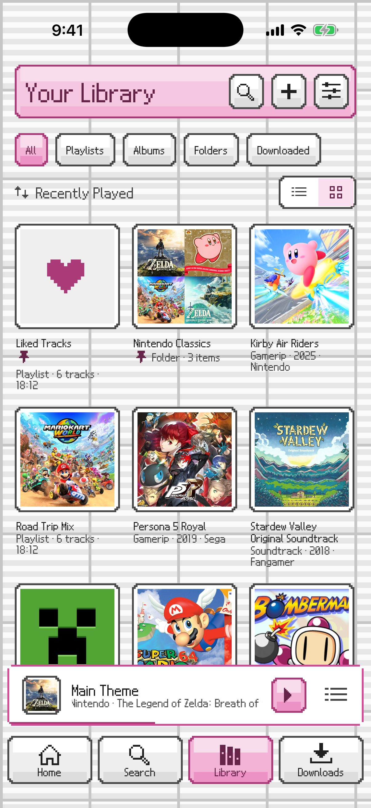 
<b>Figure 43 — Library grid</b> Covers in ink frames with pixel corners.
</td>
<td align="center" width="280">
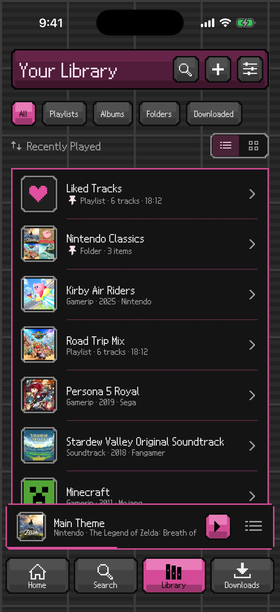 
<b>Figure 44 — Library in dark</b> The list view on the graphite grid.
</td>
</tr></table>
<table><tr>
<td align="center" width="280">
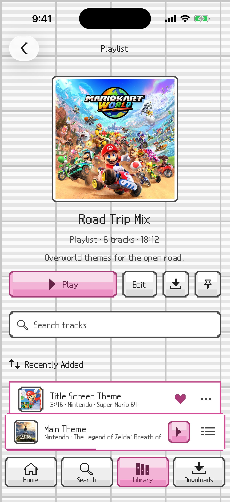 
<b>Figure 45 — Playlist</b> A playlist page with DS Play, Edit, Download, and Pin buttons.
</td>
<td align="center" width="280">
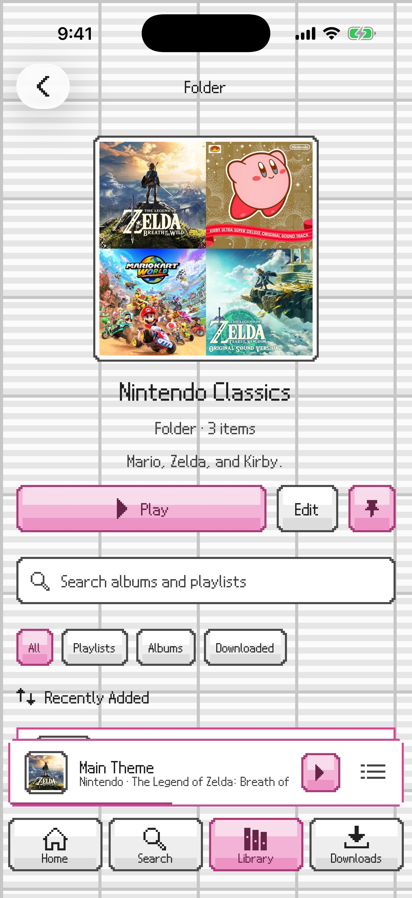 
<b>Figure 46 — Folder</b> A folder of albums with its own search and filters.
</td>
<td align="center" width="280">
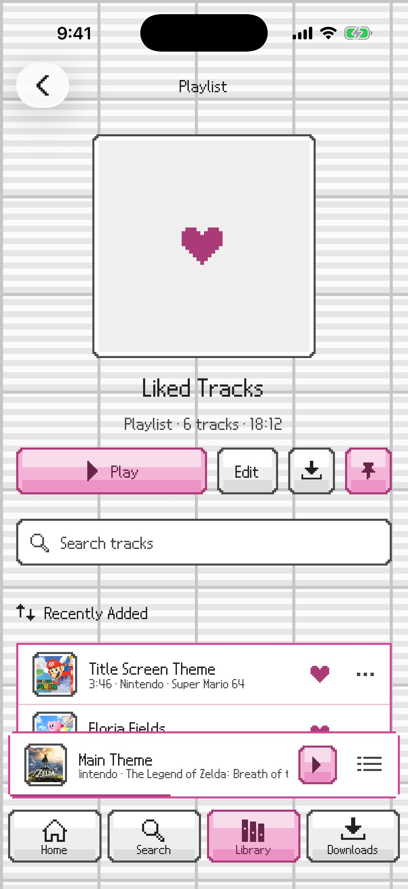 
<b>Figure 47 — Liked Tracks</b> A pixel heart for Liked Tracks.
</td>
</tr></table>
<table><tr>
<td align="center" width="280">
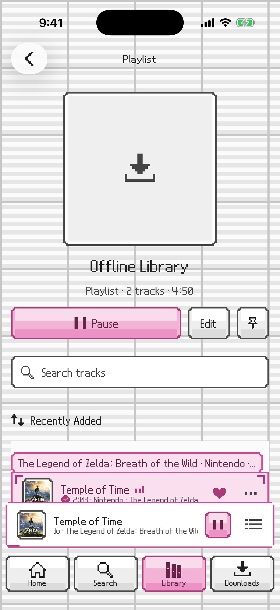 
<b>Figure 48 — Offline Library</b> The playing track marked with the DS's colored corner brackets and square EQ bars.
</td>
<td align="center" width="280"></td>
<td align="center" width="280"></td>
</tr></table>

<a href="#vgmu-gallery">↑ back to top</a>

---

## PictoChat · Playback

<b>Now Playing frames the cover and the title as two messages, over its own Now Playing background.</b>

<table><tr>
<td align="center" width="280">
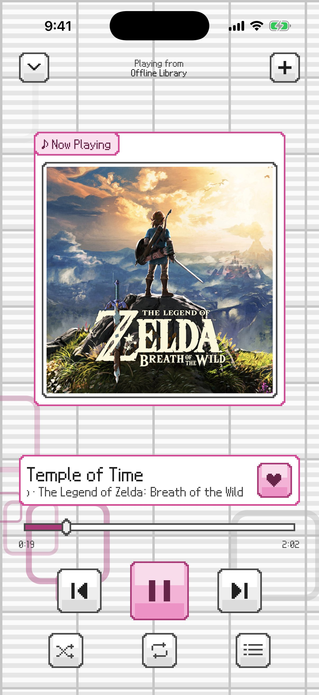 
<b>Figure 49 — Now Playing — Squares</b> The DS boot screen's outlined squares fade in and out behind the player (the default background).
</td>
<td align="center" width="280">
 
<b>Figure 50 — Now Playing — Chat</b> A faint pretend chat room behind the player: people come and go, type messages, and send hand-drawn pictures that draw themselves in.
</td>
<td align="center" width="280">
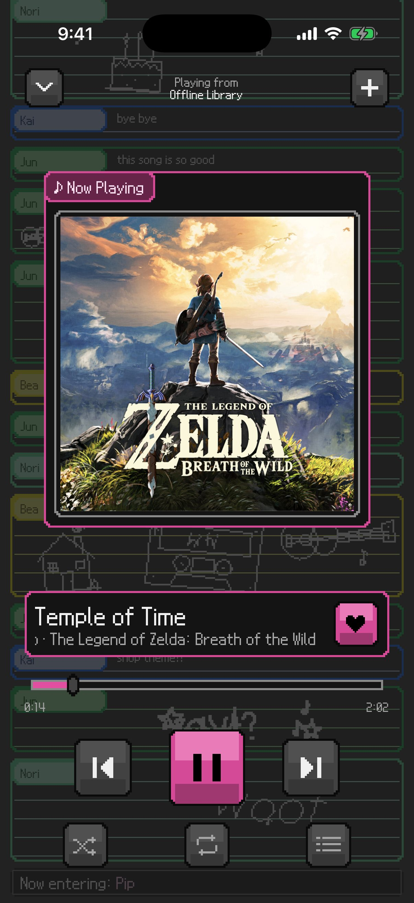 
<b>Figure 51 — Chat in dark</b> The chat room on the dark canvas.
</td>
</tr></table>
<table><tr>
<td align="center" width="280">
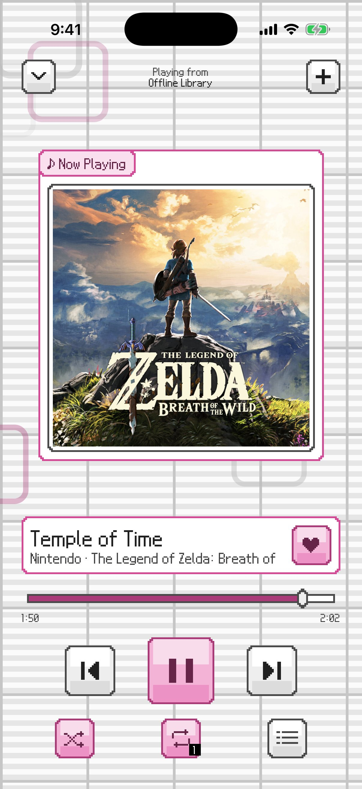 
<b>Figure 52 — Shuffle and repeat one</b> Selected buttons fill with your color and keep their icons legible. Repeat one gets a small black DS badge.
</td>
<td align="center" width="280">
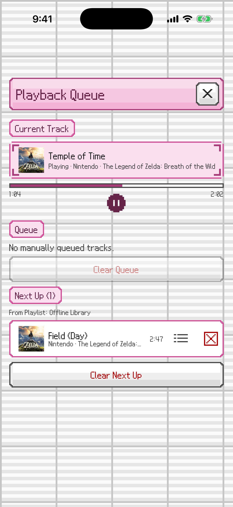 
<b>Figure 53 — Playback Queue</b> Name tabs for each part of the queue and the selection corners on the current track.
</td>
<td align="center" width="280"></td>
</tr></table>

<a href="#vgmu-gallery">↑ back to top</a>

---

## PictoChat · Look

<b>Make PictoChat yours: your DS color, the background, the font, and more, under Settings → Look.</b>

<table><tr>
<td align="center" width="280">
 
<b>Figure 54 — Your color</b> Fifteen of the DS's sixteen user colors in the DS's own 4 × 4 grid, plus a custom color picker (the pink here).
</td>
<td align="center" width="280">
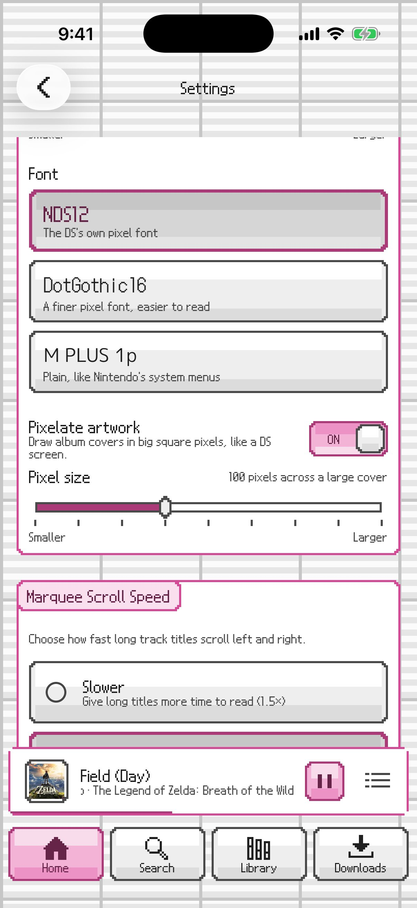 
<b>Figure 55 — Fonts and pixel art</b> NDS12 (the DS's own pixel font), DotGothic16, or M PLUS 1p, each shown in its own face, plus Pixelate artwork with a Pixel size slider.
</td>
<td align="center" width="280">
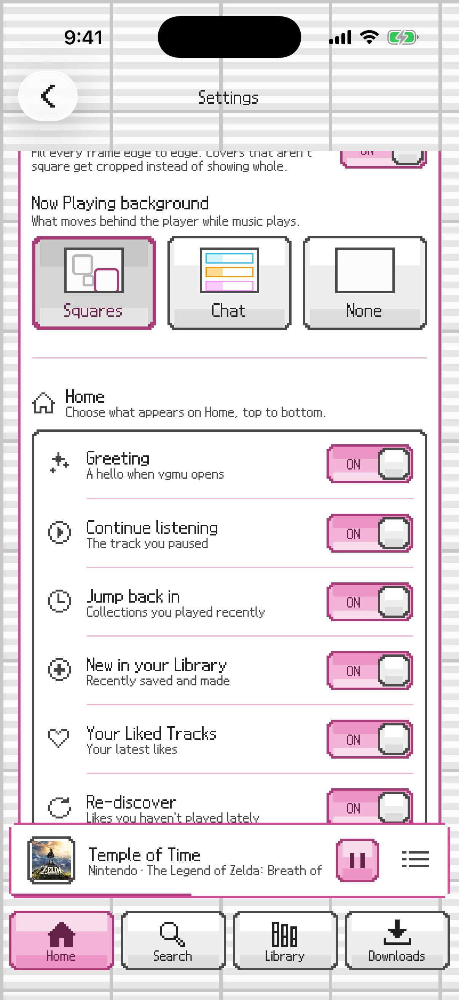 
<b>Figure 56 — Now Playing background</b> Squares, Chat, or None, and the Home switches as DS ON/OFF toggles.
</td>
</tr></table>
<table><tr>
<td align="center" width="280">
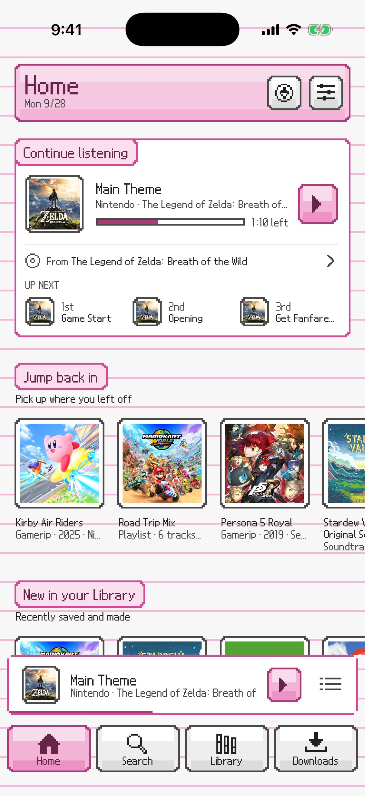 
<b>Figure 57 — Paper lines background</b> Lined paper ruled in your color, like a PictoChat message, instead of the grid.
</td>
<td align="center" width="280">
 
<b>Figure 58 — Library on paper</b> The Library on the lined paper background.
</td>
<td align="center" width="280">
 
<b>Figure 59 — Smaller grid</b> The Grid size slider shows more of the grid, like the DS screen.
</td>
</tr></table>
<table><tr>
<td align="center" width="280">
 
<b>Figure 60 — DotGothic16</b> A finer pixel font that is easier to read, with full Japanese.
</td>
<td align="center" width="280">
 
<b>Figure 61 — M PLUS 1p</b> A plain sans, like Nintendo's system menus.
</td>
<td align="center" width="280">
 
<b>Figure 62 — Pixelated artwork</b> Pixelate artwork redraws every album cover in square pixels, like a DS screen (3 pt pixels here).
</td>
</tr></table>
<table><tr>
<td align="center" width="280">
 
<b>Figure 63 — Pixelated Library</b> The Library grid with every cover pixelated.
</td>
<td align="center" width="280">
 
<b>Figure 64 — Pixelated Now Playing</b> At the finest sizes the big cover keeps its detail, drawn about 100 pixels across.
</td>
<td align="center" width="280">
 
<b>Figure 65 — Bigger pixels</b> The Pixel size slider goes from 1.5 to 6 pt; this is the coarsest, about 50 pixels across.
</td>
</tr></table>
<table><tr>
<td align="center" width="280">
 
<b>Figure 66 — Interface style</b> The Interface style cards drawn in PictoChat.
</td>
<td align="center" width="280"></td>
<td align="center" width="280"></td>
</tr></table>

<a href="#vgmu-gallery">↑ back to top</a>

---

## PictoChat · Downloads and settings

<b>The rest of the app, drawn the DS way.</b>

<table><tr>
<td align="center" width="280">
 
<b>Figure 67 — Downloads</b> Each section a message with its name tab.
</td>
<td align="center" width="280">
 
<b>Figure 68 — Backup & Restore</b> Export and Import as DS buttons.
</td>
<td align="center" width="280">
 
<b>Figure 69 — Help</b> The guide's topics as DS buttons.
</td>
</tr></table>
<table><tr>
<td align="center" width="280">
 
<b>Figure 70 — About</b> About and update check in message panels.
</td>
<td align="center" width="280"></td>
<td align="center" width="280"></td>
</tr></table>

<a href="#vgmu-gallery">↑ back to top</a>

---

## Clean · Home and library

<b>Clean is the original, restrained vgmu look, with the same Home, Library, and features. It keeps the color themes and the Simple UI accent (pink here).</b>

<table><tr>
<td align="center" width="280">
 
<b>Figure 71 — Home and greeting</b> The greeting under the Home title, then Continue listening and Jump back in, drawn plainly with nothing animating.
</td>
<td align="center" width="280">
 
<b>Figure 72 — Home</b> The same Home rows as Console and PictoChat, turned on or off in Settings.
</td>
<td align="center" width="280">
 
<b>Figure 73 — Home in dark</b> Simple UI follows the device's dark appearance.
</td>
</tr></table>
<table><tr>
<td align="center" width="280">
 
<b>Figure 74 — Library</b> Filter chips, sort, and a list or grid.
</td>
<td align="center" width="280">
 
<b>Figure 75 — Library grid</b> Large rounded covers.
</td>
<td align="center" width="280">
 
<b>Figure 76 — Library in dark</b> The Library in dark appearance.
</td>
</tr></table>
<table><tr>
<td align="center" width="280">
 
<b>Figure 77 — Playlist</b> A playlist with its own cover and description.
</td>
<td align="center" width="280">
 
<b>Figure 78 — Folder</b> A folder with a collage cover of the albums inside.
</td>
<td align="center" width="280">
 
<b>Figure 79 — Liked Tracks</b> Liked Tracks in the accent color.
</td>
</tr></table>

<a href="#vgmu-gallery">↑ back to top</a>

---

## Clean · Browse, albums, and playback

<b>Browse, albums, and Now Playing in Clean.</b>

<table><tr>
<td align="center" width="280">
 
<b>Figure 80 — Browse — All-Time Top 100</b> Random Album, Random Song, and the chart presets.
</td>
<td align="center" width="280">
 
<b>Figure 81 — Album</b> Album metadata and description with Play, Pin, and Save.
</td>
<td align="center" width="280">
 
<b>Figure 82 — Now Playing</b> The classic player with like, shuffle, repeat, and the queue.
</td>
</tr></table>
<table><tr>
<td align="center" width="280">
 
<b>Figure 83 — Downloads</b> The download manager in Clean.
</td>
<td align="center" width="280"></td>
<td align="center" width="280"></td>
</tr></table>

<a href="#vgmu-gallery">↑ back to top</a>

---

## Clean · Settings and themes

<b>Clean keeps Simple UI's accent colors and the full set of color themes.</b>

<table><tr>
<td align="center" width="280">
 
<b>Figure 84 — Interface style</b> The Interface style cards in Clean.
</td>
<td align="center" width="280">
 
<b>Figure 85 — Simple UI accent</b> Appearance, the accent swatches with a custom color, and Browse all themes.
</td>
<td align="center" width="280">
 
<b>Figure 86 — Kawaii Pink theme</b> Pastel surfaces with a sweet berry accent.
</td>
</tr></table>
<table><tr>
<td align="center" width="280">
 
<b>Figure 87 — Discord theme</b> One of the gaming themes: dark community surfaces with the classic blurple accent.
</td>
<td align="center" width="280">
 
<b>Figure 88 — Backup & Restore</b> Export, Import, and Auto Backup.
</td>
<td align="center" width="280">
 
<b>Figure 89 — Help</b> The in-app guide.
</td>
</tr></table>
<table><tr>
<td align="center" width="280">
 
<b>Figure 90 — About</b> Version and update check.
</td>
<td align="center" width="280"></td>
<td align="center" width="280"></td>
</tr></table>

<a href="#vgmu-gallery">↑ back to top</a>

---

## Everywhere · Albums and library tools

<b>Features that work the same in every interface (shown here in Clean).</b>

<table><tr>
<td align="center" width="280">
 
<b>Figure 91 — Artwork gallery</b> Browse alternate cover art and logo variants from the catalog.
</td>
<td align="center" width="280">
 
<b>Figure 92 — Save artwork</b> Save high-resolution artwork to Photos or Files.
</td>
<td align="center" width="280">
 
<b>Figure 93 — Add to playlist</b> Choose a playlist for a track, or start a new one.
</td>
</tr></table>
<table><tr>
<td align="center" width="280">
 
<b>Figure 94 — Add tracks</b> Pick tracks from All, Local, or Liked views.
</td>
<td align="center" width="280">
 
<b>Figure 95 — Local Library import</b> Import audio straight from the device's files.
</td>
<td align="center" width="280">
 
<b>Figure 96 — Import progress</b> Batch-importing local files with a live progress bar.
</td>
</tr></table>
<table><tr>
<td align="center" width="280">
 
<b>Figure 97 — Rounded artwork</b> Circular cover art, turned on in Settings.
</td>
<td align="center" width="280">
 
<b>Figure 98 — Swipe to next track</b> Swipe the player sideways to change tracks.
</td>
<td align="center" width="280"></td>
</tr></table>

<a href="#vgmu-gallery">↑ back to top</a>

---

## Everywhere · Downloads and backups

<b>Offline saving and backups, in every interface.</b>

<table><tr>
<td align="center" width="280">
 
<b>Figure 99 — Batch download</b> Grab the rest of an album's tracks in one go.
</td>
<td align="center" width="280">
 
<b>Figure 100 — Download confirmation</b> Confirm a download before it starts (optional).
</td>
<td align="center" width="280">
 
<b>Figure 101 — Cancel options</b> Cancel one track, the rest of the queue, or keep going.
</td>
</tr></table>
<table><tr>
<td align="center" width="280">
 
<b>Figure 102 — Download History</b> File name, format, size, timestamps, and checksum for a verified download.
</td>
<td align="center" width="280">
 
<b>Figure 103 — Download quality</b> Best Available, FLAC, M4A/AAC, MP3, or OGG.
</td>
<td align="center" width="280">
 
<b>Figure 104 — Export a backup</b> Playlists, folders, likes, custom art, and settings in one file, through the share sheet.
</td>
</tr></table>
<table><tr>
<td align="center" width="280">
 
<b>Figure 105 — Auto Backup</b> Back up automatically, from every app open to weekly.
</td>
<td align="center" width="280"></td>
<td align="center" width="280"></td>
</tr></table>

<a href="#vgmu-gallery">↑ back to top</a>

---

## Everywhere · System and Discord

<b>Lock screen controls, the Home Screen icon, and Discord Rich Presence.</b>

<table><tr>
<td align="center" width="280">
 
<b>Figure 106 — Lock screen controls</b> System playback controls while the phone is locked.
</td>
<td align="center" width="280">
 
<b>Figure 107 — Lock screen artwork</b> Full album art on the lock screen during background playback.
</td>
<td align="center" width="280">
 
<b>Figure 108 — iOS icon</b> Default, Dark, Clear, and Tinted Home Screen icons.
</td>
</tr></table>
<table><tr>
<td align="center" width="280">
 
<b>Figure 109 — Storage and Discord</b> Storage by type, and the optional Discord Rich Presence connection.
</td>
<td align="center" width="280">
 
<b>Figure 110 — Discord profile</b> What you are playing, live on your Discord profile.
</td>
<td align="center" width="280">
 
<b>Figure 111 — Discord progress</b> "Last Surprise" from <i>Persona 5 Royal</i> with a live progress bar.
</td>
</tr></table>

<a href="#vgmu-gallery">↑ back to top</a>

---

Three looks, one library. Download now!

