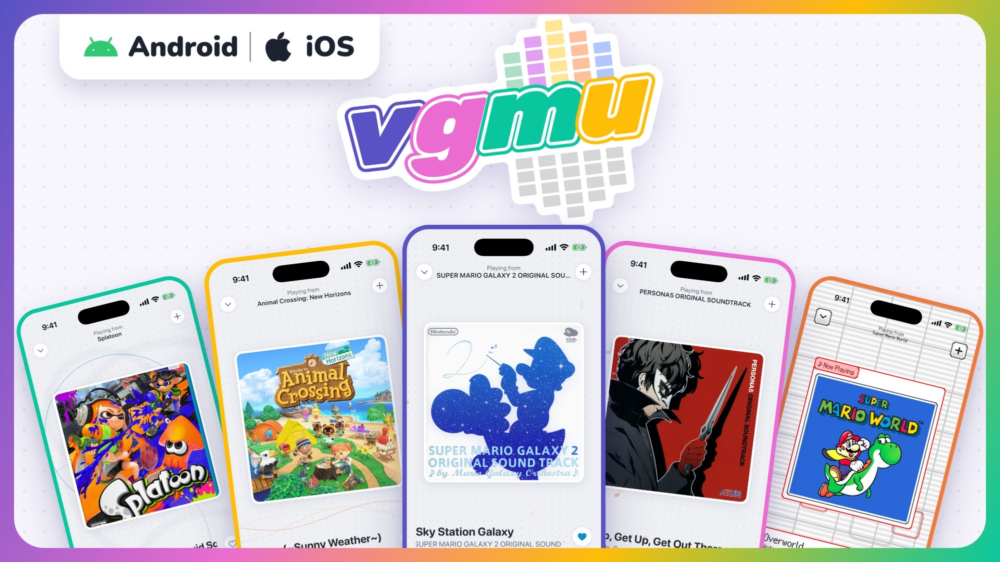
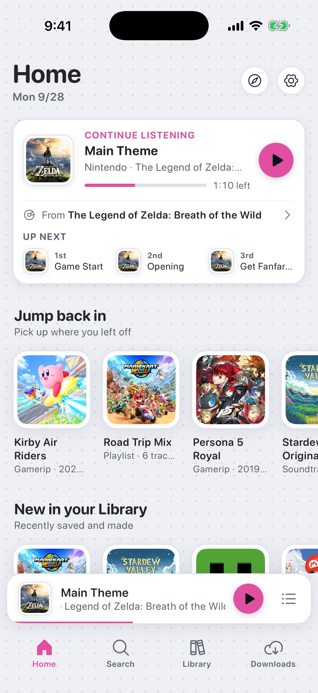
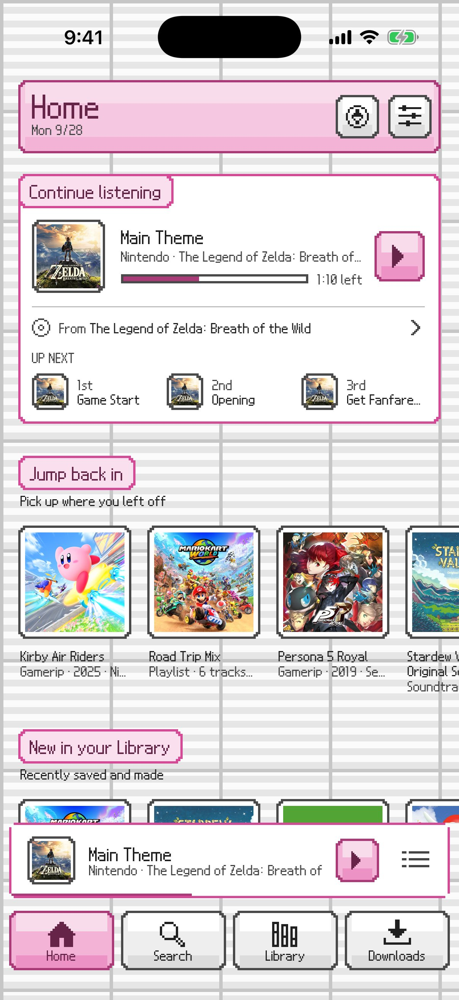
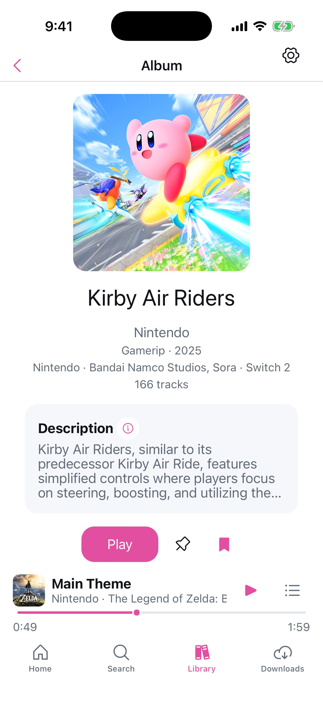
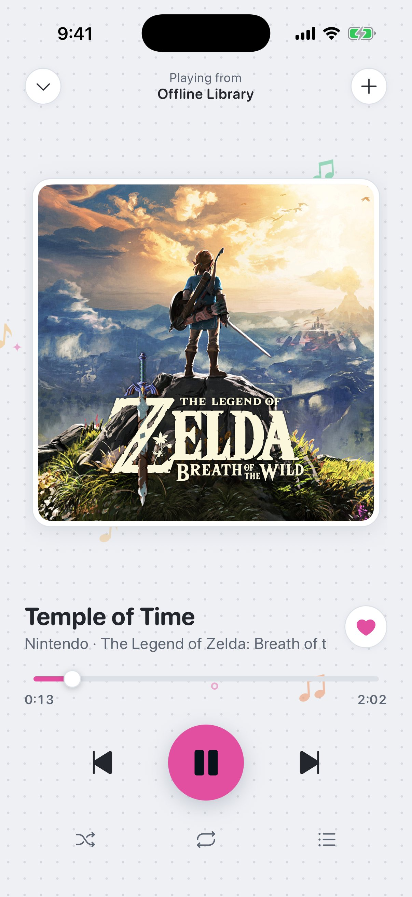
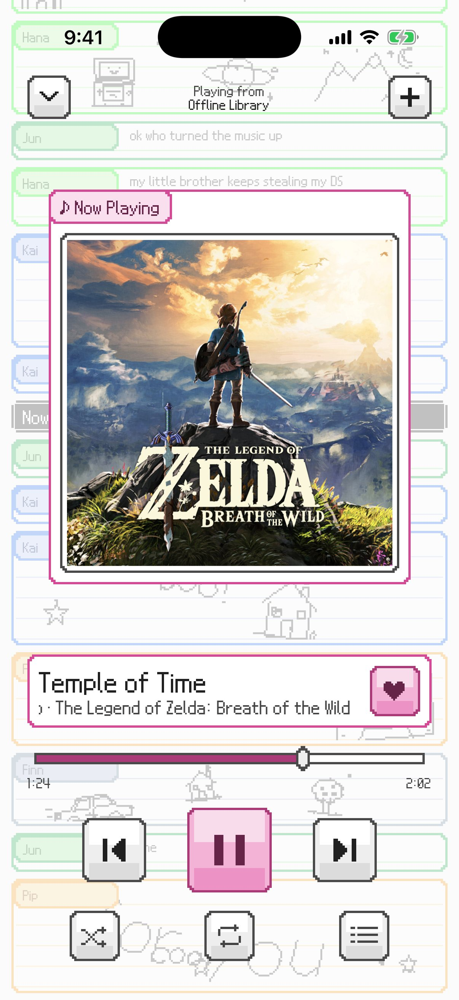
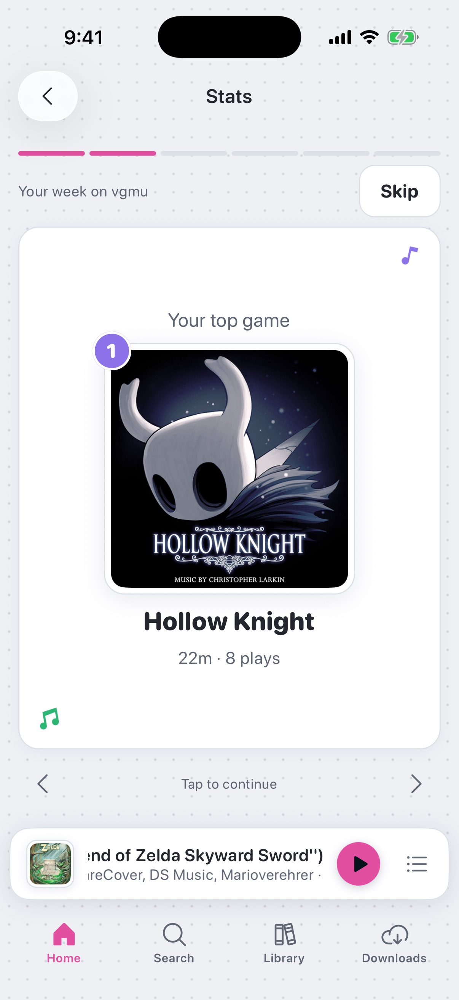
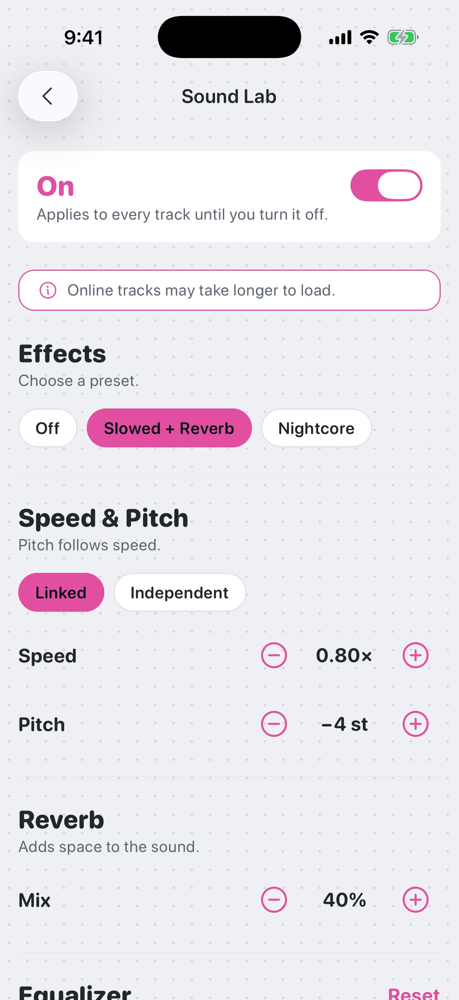
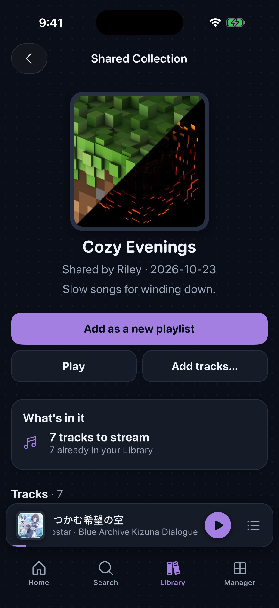

**[Website](https://vgmu.kylekhai.workers.dev/) · [README](README.md) · [Installation](docs/INSTALLATION.md) · [Getting Started](docs/GETTING_STARTED.md) · [Usage](docs/USAGE_GUIDE.md) · [Gallery](GALLERY.md) · [Support](SUPPORT.md) · [Security](SECURITY.md) · [Privacy](PRIVACY.md) · [EULA](EULA.md) · [License](LICENSE.md)**

---

# vgmu: a mobile video game music player

A free video game music app for iOS and Android. vgmu lets you discover, organize, and listen to your favourite game soundtracks. Stream them or save them for offline listening, with no subscription.

**Live site: [vgmu.kylekhai.workers.dev](https://vgmu.kylekhai.workers.dev/)**

  

## Release video

**[Watch on YouTube](https://youtu.be/GJJtDR0O88g)**

---

## Download

- **Current release:** [v1.5.0, November 7, 2026](https://github.com/KYLEKHAI/vgmu-releases/releases/tag/v1.5.0)
- **Android:** Start with the [APK installation guide](docs/INSTALLATION.md#android).
- **iOS:** Sideload with [AltStore Classic or SideStore](docs/INSTALLATION.md#ios).
- [Latest GitHub release](https://github.com/KYLEKHAI/vgmu-releases/releases/latest) · [SHA-256 checksums](https://github.com/KYLEKHAI/vgmu-releases/releases/download/v1.5.0/vgmu-1.5.0-SHA256SUMS.txt)

**Website:** [vgmu.kylekhai.workers.dev](https://vgmu.kylekhai.workers.dev/), with the install guides, FAQ and a tour of every screen.

See the [installation guide](docs/INSTALLATION.md) for detailed setup instructions.

## A look at the app

  
  
  
  

  
  
  
  

## Quick links

- [Installation guide](docs/INSTALLATION.md): How to install vgmu
- [Getting started guide](docs/GETTING_STARTED.md): First steps with vgmu
- [Usage guide](docs/USAGE_GUIDE.md): Features and how to use them
- [Gallery](GALLERY.md): Full screenshot tour of every screen
- [Support and troubleshooting](SUPPORT.md): FAQ and common issues
- [Report a bug](../../issues/new?template=bug_report.md) or [send feedback](https://vgmu.kylekhai.workers.dev/feedback/)

## About

vgmu is a personal project for enjoying video game music on mobile. For questions, see [Support](SUPPORT.md).

**Version:** 1.5.0

## Follow and support vgmu

## Closed source

**vgmu is closed source.** This repository contains release distribution material, documentation, and user guides. Neither the application source nor the website source is available here. See [LICENSE](LICENSE.md) for details.

**Note:** GitHub source archives (`.zip`, `.tar.gz`) provided below contain public repository files such as documentation; they are neither the application source nor installable binaries.

## Made possible with

Expo, and online video game music archives

  
  

